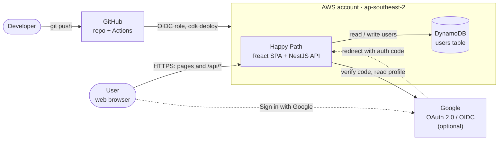
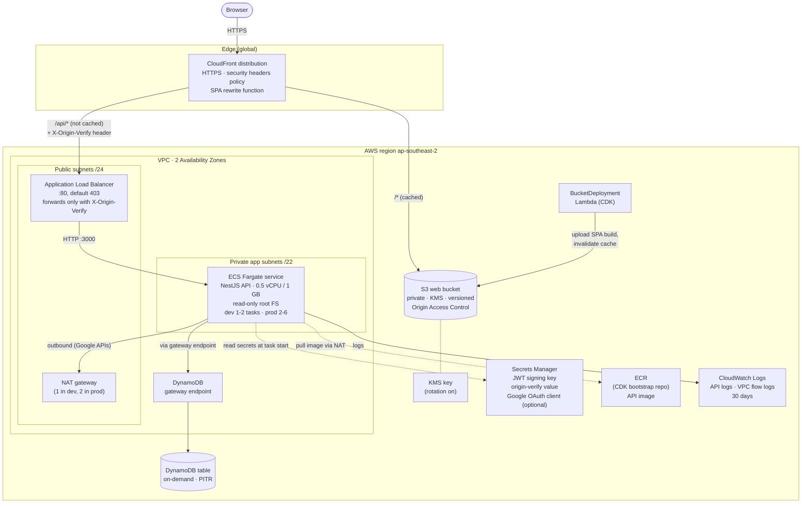
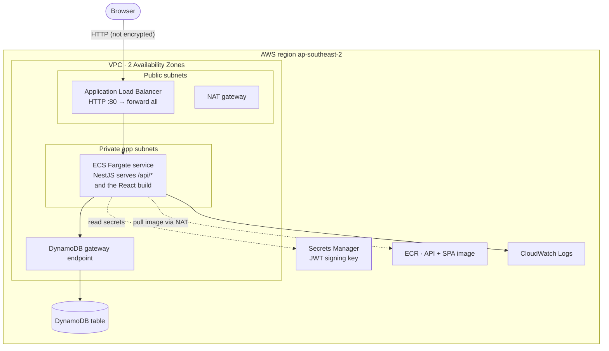
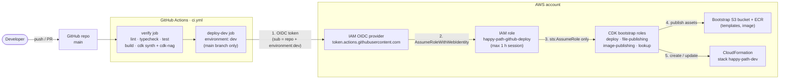
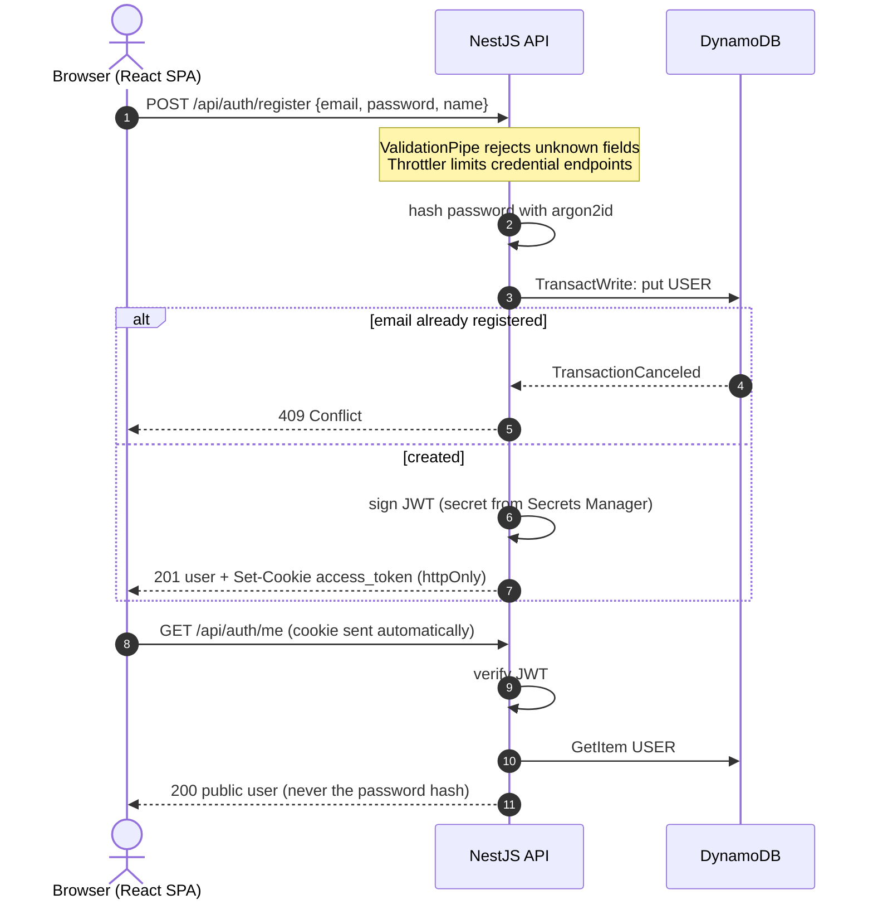
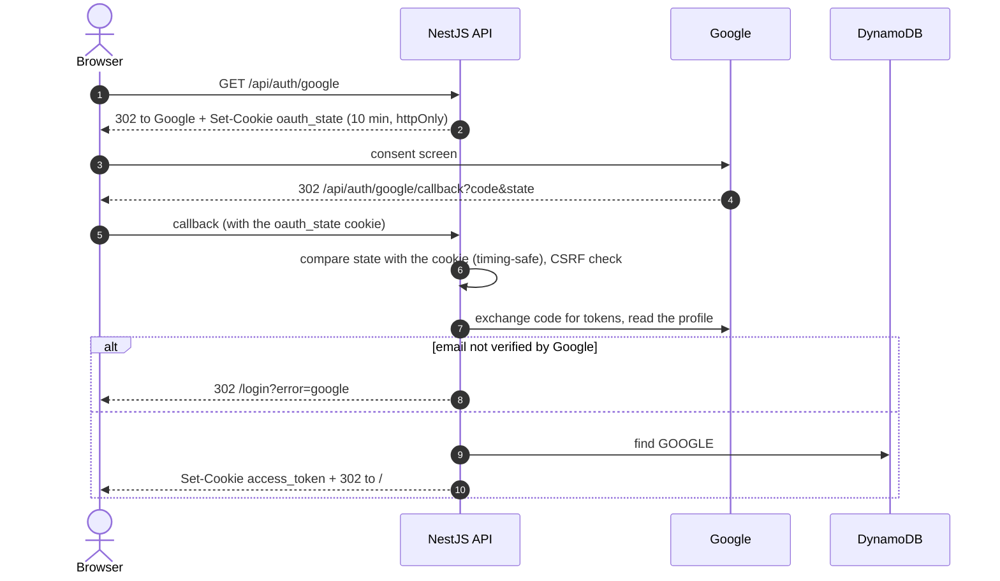
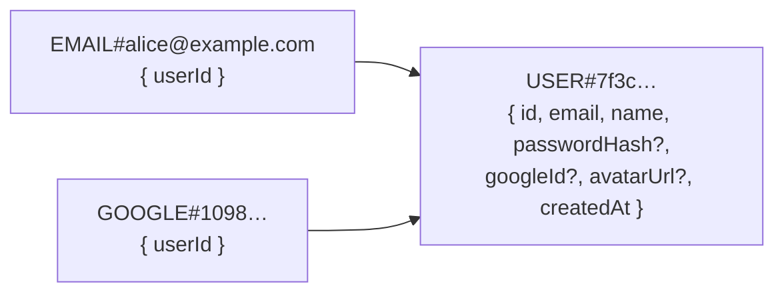
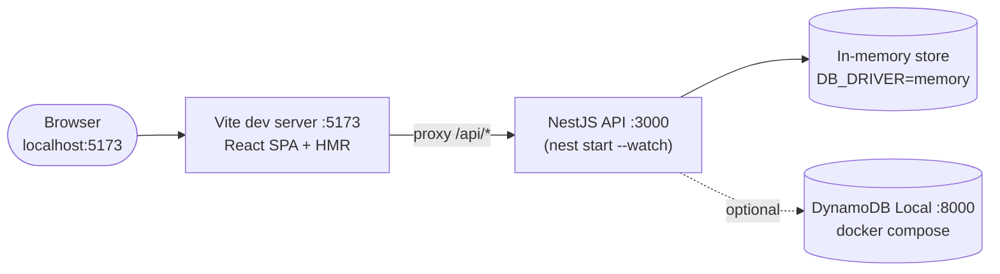

# Happy Path: Cloud Architecture

This document describes how the Happy Path application (this repository) runs on AWS: the infrastructure,
how requests flow, how code gets deployed, and which security controls are in place. Everything here is
defined in code. The source of truth is [`infra/lib/poc-stack.ts`](../infra/lib/poc-stack.ts),
[`infra/lib/github-oidc-stack.ts`](../infra/lib/github-oidc-stack.ts) and
[`.github/workflows/ci.yml`](../.github/workflows/ci.yml).

The diagrams use Mermaid and render on GitHub and in VS Code (with a Mermaid preview extension).

| | |
|---|---|
| AWS project name | `happy-path` |
| Region | `ap-southeast-2` (Sydney) |
| Environments | `dev` (deployed), `uat` and `prod` (defined in code, not deployed yet) |
| Stacks | `happy-path-<env>` (application), `happy-path-github-oidc` (CI access, one per account) |
| Hosting modes | `cloudfront` (target design), `alb` (temporary, dev only, used today) |

---

## 1. System overview

The browser loads the React single-page app (SPA) and calls the API under `/api/*` on the **same origin**.
The session is an httpOnly cookie that holds a signed JWT, so the SPA never handles tokens and no CORS is needed.

---

## 2. AWS architecture: target design (`hosting=cloudfront`)

This is the intended design for all environments. It needs CloudFront to be enabled on the account
(see [section 3](#3-aws-architecture-current-dev-hostingalb) for today's dev setup).

### How a request is routed

| Path | CloudFront behavior | Origin | Caching |
|---|---|---|---|
| `/*` | HTTP redirects to HTTPS. The SPA rewrite function sends paths without a file extension to `/index.html` | S3 via Origin Access Control | `CachingOptimized` |
| `/api/*` | HTTPS only; all methods; forwards cookies, query strings and headers except `Host` | ALB, with the secret `X-Origin-Verify` header added | Disabled |

The ALB is internet-facing because CloudFront needs to reach it, but its listener answers **403** to any
request without the correct `X-Origin-Verify` header. That value is generated in Secrets Manager and resolved
by CloudFormation at deploy time, so it never appears in the template or the code.

---

## 3. AWS architecture: current dev (`hosting=alb`)

The AWS account is not yet allowed to create CloudFront distributions ("Your account must be verified before
you can add new CloudFront resources"). Until AWS Support verifies the account, **dev** runs in a temporary
mode, switched on by the GitHub repository variable `HOSTING=alb`. The stack refuses this mode for uat and prod.

| | `hosting=cloudfront` (target) | `hosting=alb` (temporary) |
|---|---|---|
| Public URL | `https://<id>.cloudfront.net` | `http://<alb-dns-name>` |
| Who serves the SPA | S3 behind CloudFront | The API container ([`apps/api/src/web-hosting.ts`](../apps/api/src/web-hosting.ts)) |
| Transport | HTTPS from browser to CloudFront | **Plain HTTP**: use test accounts and test passwords only |
| ALB exposure | Only requests carrying the origin-verify header | All requests |
| Security headers | CloudFront `SECURITY_HEADERS` policy + Helmet | Helmet only (no HSTS, no upgrade-insecure-requests) |
| Session cookie | `Secure; HttpOnly; SameSite=Lax` | `HttpOnly; SameSite=Lax` (Secure would be dropped over HTTP) |
| Google sign-in | Works | Does not work (Google needs an https redirect URI) |
| Resources not created | none | CloudFront, S3 bucket, KMS key, origin-verify secret, BucketDeployment Lambda |

**To return to the target design:** delete the `HOSTING` variable in GitHub and re-run the workflow.

---

## 4. CI/CD and deployment

| Step | What happens |
|---|---|
| Every PR and push | `verify` runs every quality gate. `cdk synth` fails on any cdk-nag (AwsSolutions) finding that has not been acknowledged with a reason |
| Push to `main` | `deploy-dev` gets a short-lived GitHub OIDC token. **No AWS keys are stored in GitHub** |
| Trust | The role trusts only tokens whose `sub` is this repo's `dev` environment (GitHub's immutable subject format, `githubSubjectPrefix` in `infra/cdk.json`) |
| Permissions | The role can only assume the CDK bootstrap roles, so what it can change is bounded by the bootstrap |
| Build | CDK builds the Docker image from [`apps/api/Dockerfile`](../apps/api/Dockerfile) (API + built SPA), pushes it to ECR, then deploys the stack |
| Result | The app URL is written to the run summary and the `dev` environment page |

One-time setup (already done for this account): `cdk bootstrap`, then deploy the `happy-path-github-oidc`
stack from a laptop with `aws login`, then set the GitHub variables. See the README.

---

## 5. Request flows

### 5.1 Register and sign in (email and password)

Sign-in (`POST /api/auth/login`) looks up `EMAIL#email`, then `USER#id`, and verifies the argon2id hash.
When the email does not exist it still runs a dummy hash, so response times do not reveal which emails are registered.

### 5.2 Sign in with Google (OAuth 2.0 authorization code flow)

Google sign-in is switched on only when a Google OAuth client is configured (Secrets Manager in AWS,
`.env` locally). Otherwise `/api/auth/google` returns 404 and the SPA hides the button.

---

## 6. Data model (DynamoDB single-table)

One table with a string partition key `pk`, no sort key, no secondary indexes, on-demand billing,
point-in-time recovery on.

| Item `pk` | Purpose | Written with |
|---|---|---|
| `USER#<id>` | The user profile | `attribute_not_exists(pk)` on create |
| `EMAIL#<email>` | Pointer to the user; makes emails unique | Same transaction as the user item |
| `GOOGLE#` | Pointer to the user; one user per Google account | Same transaction (or when linking) |

Uniqueness is guaranteed by DynamoDB conditional transactional writes, not by application checks, so two
simultaneous sign-ups with the same email cannot both succeed.

---

## 7. Security controls

| Area | Control | Where |
|---|---|---|
| Identity for CI | GitHub OIDC; no long-lived AWS keys; role limited to CDK bootstrap roles and the `dev` environment | `infra/lib/github-oidc-stack.ts` |
| Passwords | argon2id (19 MiB memory, 2 iterations); dummy hash for unknown emails | `apps/api/src/auth/auth.service.ts` |
| Session | Signed JWT in an httpOnly, SameSite=Lax cookie; Secure whenever the public URL is https | `apps/api/src/auth/auth-cookie.ts` |
| OAuth CSRF | Random `state` in a short-lived httpOnly cookie, compared in constant time | `apps/api/src/auth/oauth-state.store.ts` |
| Input | Global ValidationPipe; unknown fields rejected | `apps/api/src/main.ts` |
| Abuse | Rate limiting on credential endpoints | `@nestjs/throttler` |
| Headers | Helmet; CloudFront security headers policy | `main.ts`, `poc-stack.ts` |
| Secrets | Secrets Manager, injected into the task at start; never in code, env files or logs | `poc-stack.ts` |
| Network | API tasks in private subnets; DynamoDB through a gateway endpoint; ALB only forwards CloudFront traffic | `poc-stack.ts` |
| Data | S3 private + KMS + TLS-only; DynamoDB PITR; prod: deletion protection and RETAIN | `poc-stack.ts` |
| Container | Non-root `node` user, read-only root filesystem, deployment circuit breaker with rollback | `Dockerfile`, `poc-stack.ts` |
| Guardrails | cdk-nag AwsSolutions checks fail the build; every exception is acknowledged with a reason | `poc-stack.ts` |
| Audit | VPC flow logs and API logs in CloudWatch (30 days); a correlation ID on every request | `poc-stack.ts`, `request-context.middleware.ts` |

Known gaps for the POC (tracked in the README "Production hardening" list): WAF, custom domain + ACM,
access logs for ALB/CloudFront/S3, secret rotation, alarms and tracing, and HTTPS while `hosting=alb` is on.

---

## 8. Environments

| Setting | dev | uat | prod |
|---|---|---|---|
| NAT gateways | 1 | 1 | 2 |
| API tasks (min-max) | 1-2 | 1-2 | 2-6 |
| Removal policy | DESTROY | DESTROY | RETAIN |
| DynamoDB deletion protection | off | off | on |
| `hosting=alb` allowed | yes (temporary) | no | no |
| Deployed by | GitHub Actions on `main` | pipeline (not set up yet) | pipeline (not set up yet) |

Main running costs per environment: the NAT gateway, the ALB, and the Fargate task(s). DynamoDB, S3,
CloudFront and Secrets Manager cost little at POC traffic. Destroy dev when it is not in use
(`pnpm exec cdk destroy happy-path-dev`).

---

## 9. Local development

Local development mirrors AWS's single-origin setup: the Vite proxy plays the role of CloudFront, so the
cookie and routing behave the same as in AWS.
